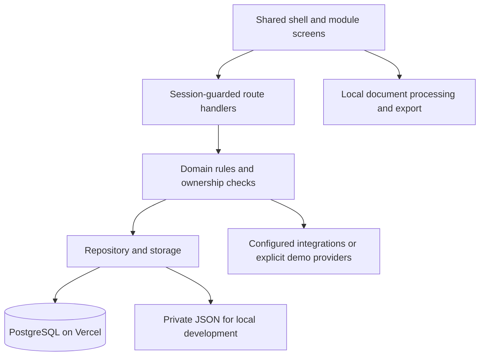
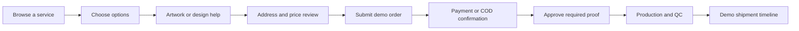

<div align="center">


# BornoLab · বর্ণল্যাব

**Create documents. Explore typography. Study smarter. Bring ideas to print.**

A Bangladesh-first workspace for students, creators, publishers and businesses.

[](https://nextjs.org/)
[](https://react.dev/)
[](https://www.typescriptlang.org/)
[](https://tailwindcss.com/)

[Live project](https://bornolab.vercel.app) · [Modules](#modules) · [Design patterns](#design-patterns) · [Quick start](#quick-start) · [Deployment](#deployment)

</div>

---

## Modules

| Workspace | What it supports | Entry point |
| --- | --- | --- |
| **Office Suite** | PDF tools, document conversion, formatting and Unicode/Bijoy conversion | `/pdf-tools`, `/bijoy-unicode-converter` |
| **Fonts & typography** | Bangla/Latin font browsing, previews, downloads and text styling | `/fonts`, `/styler` |
| **Study Hub** | Study resources, lessons, practice, exams, spaced review and progress | `/study` |
| **Question Bank Solutions** | Department → subject → chapter browsing, bilingual labels and managed solution documents | `/study/question-bank` |
| **Printing Services** | Managed catalog, artwork, quotes, proof approval and demo fulfillment | `/printing` |
| **Software** | Free resources and configured premium digital products | `/software` |
| **Account & admin** | Existing member accounts, digital orders and module administration | `/login`, `/cart`, `/admin` |

All modules share BornoLab's navigation, authentication and visual language. Printing extends the existing admin panel.

## Design language

- Shared light/dark themes, glass surfaces and cyan-to-purple accents.
- Locally hosted Latin and Bangla fonts, including Inter, Noto Sans Bengali and SolaimanLipi, with consistent spacing and hierarchy.
- Reusable cards, section titles, navigation, forms and notification components.
- Responsive grids, compact mobile ordering controls and visible keyboard focus.

Printing uses lightweight local SVG product illustrations. Seed records are fictional and explicitly marked as demo; there are no invented reviews or sales figures.

## Design patterns

The interface follows a shared workspace pattern: discover a module, complete a focused task, then preview/export or review its status. These are the existing implementation patterns to reuse when extending the project.

| Pattern | Project example | Source of truth |
| --- | --- | --- |
| **Shared visual primitives** | Frosted cards, compact section headings, rounded controls and cyan/purple emphasis across tools | [`ui.tsx`](src/components/ui.tsx), [`globals.css`](src/app/globals.css), [`cn.ts`](src/lib/cn.ts) |
| **Progressive disclosure** | Printing splits configuration, artwork, address and review into steps | [`configurator.tsx`](src/components/printing/configurator.tsx) |
| **Browse → filter → detail** | Font/software catalogs, Study resources and department/subject/chapter question banks | [`study/page.tsx`](src/app/study/page.tsx), [`question-bank`](src/app/study/question-bank/page.tsx) |
| **Reusable motion** | Fade-up sections and staggered Study cards use shared Framer Motion wrappers | [`study-motion.tsx`](src/components/study-motion.tsx) |
| **Client-first processing** | Browser document operations provide preview/export; configured n8n integrations use server proxies | [`src/app`](src/app), [`api/n8n`](src/app/api/n8n) |
| **Layered domain and repository** | Printing UI calls guarded APIs; domain rules calculate prices and transitions; the repository persists transactions | [`src/lib/printing`](src/lib/printing) |
| **Provider boundaries** | Demo payment, shipping and file scanning have explicit adapters for future integration | [`providers.ts`](src/lib/printing/providers.ts), [`scanning.ts`](src/lib/printing/scanning.ts) |
| **Immutable snapshots and state gates** | Submitted prices remain stable; current proof approval and payment/COD confirmation control production | [`domain.ts`](src/lib/printing/domain.ts) |
| **Configuration-driven modules** | Existing admin settings control tool visibility, catalogs, SEO and Study behavior | [`site-config-shared.ts`](src/lib/site-config-shared.ts), [`admin/page.tsx`](src/app/admin/page.tsx) |



The storage policies differ intentionally: the legacy JSON store can fall back to local files/memory, while printing fails closed when its configured database is unavailable. Printing uses one locked JSONB aggregate, so it is a small demo architecture rather than a high-volume commerce backend.

## Quick start

Use **Node.js 22** and npm, matching the CI runtime.

```bash
npm ci
```

Copy `.env.example` to `.env.local`, configure the services you need, then start:

```bash
npm run dev
```

Open [localhost:3000](http://localhost:3000). Local printing can use private `data/printing.json` without a database. Durable storage and configured authentication are required for production.

| Variable | Purpose |
| --- | --- |
| `POSTGRES_URL` or `DATABASE_URL` | Existing pooled PostgreSQL connection; printing requires its migration |
| `ADMIN_EMAIL`, `ADMIN_PASSWORD` | Existing configured admin account |
| `ADMIN_JWT_SECRET`, `USER_JWT_SECRET` | Strong session/signing secrets; configure production authentication as described in the admin guide |
| `PRINTING_LOCAL_STORAGE` | Optional persistent single-process self-host override; leave disabled on Vercel |
| Existing auth, SMTP and integration variables | See `.env.example` and the admin/deployment guides |

Keep credentials in environment variables or ignored `.env.local` files. Never commit them.

## Printing Services

> **Managed demo release:** payment completion is simulated, shipments use demo references, and no money is collected or physical products fulfilled. Live payment, courier, SMS, email and payout integrations are disabled.

**Release — 2026-10-17:** printing is enabled in demo mode. The new admin includes form-based service/category/pricing/options editors, durable mockup uploads, cover/gallery management, design references, partner records and printing settings. See the [workspace guide](docs/admin-workspaces.md) for direct links and instructions.



### Available now

- **Catalog:** 16 categories, 20 services, configurable materials/options, quantity tiers, Bangla/English content and integer-paisa pricing.
- **Ordering:** saved drafts, private artwork, Bangladesh-friendly addresses, transparent totals, design help and reorder templates.
- **Operations:** versioned quotes, customer proof approval, production gates, QC records, mock shipping and separate COD confirmation/collection states.
- **Account:** print history, proof previews, support, return review and owner-scoped in-app notifications.
- **Admin:** catalog/settings, orders, partners/designers, quotes, production, financial adjustments, metrics, audit history and exports.

| Route | Screen |
| --- | --- |
| `/printing` | Catalog, search and categories |
| `/printing/[slug]` | Service details and ordering |
| `/printing/orders` | Authenticated orders, proofs, payments and support |
| `/print-orders` | Alias for the print order workspace |
| `/printing/quote` | Authenticated quote requests and offers |
| `/printing/quote/[id]` | Accepted quote checkout |
| `/printing/help` | File preparation and ordering help |
| `/admin` → **Printing Services** | Existing admin's printing operations |

### Database setup

Printing adds a single isolated `bornolab_printing` JSONB table. Existing users, digital orders, Study data and `bornolab_kv` are preserved.

With the intended database URL available in the process environment or `.env.local`:

```bash
npm run db:migrate:printing
npm run db:migrate:printing -- --check
```

The command applies [001-printing.sql](docs/migrations/001-printing.sql) transactionally and verifies the resulting table. `--check` verifies without changing the schema. It does not insert demo financial records or migrate local orders into production.

For Vercel, run the migration from a trusted machine with access to the project's **production** database environment before deploying. Do not add a public migration endpoint or run schema changes in every request. Backup, restore and admin procedures are in the [printing runbook](docs/printing-services-runbook.md).

## Privacy and operational boundaries

Browser-based tools process documents locally where supported. Features using configured server integrations can upload data; printing artwork is intentionally uploaded to private server storage. See `/privacy` for the product disclosure.

Printing enforces ownership, MIME/signature/size checks, expiring session-bound download links and audited operational changes. Submitted price snapshots are immutable; financial corrections use append-only adjustments. Required proof approval and payment/COD confirmation gate production.

Before real commerce, replace the demo file aggregate with private object storage and scanning, implement approved live providers and reconciliation, complete staging database verification, and run browser/mobile/accessibility checks. Creator publishing, supplier logins, royalties and full Bangla interface translation remain deferred.

## Development checks

```bash
npm run typecheck
npm run lint
node --test tests/*.test.mjs
npm run build
```

Printing tests cover pricing, permissions, private files, state transitions, quote conversion, proof rules, failed mock payment retries, QC/shipping, COD/refund adjustments and offline-cache privacy. Route tests use mocked authentication/storage; they do not replace browser E2E or real PostgreSQL tests. Validation details are recorded in the [runbook](docs/printing-services-runbook.md#validation-and-remaining-launch-work).

GitHub Actions runs lint, type checking and a production build for pushes and pull requests to `main`.

## Project map

```text
src/app/                     Existing routes and API handlers
  printing/                  Printing storefront and member screens
  api/printing/              Customer printing APIs
  api/admin/printing/        Protected admin operations
src/components/printing/     Printing UI using shared BornoLab components
src/components/admin-printing.tsx
src/lib/printing/            Domain, pricing, state machines, storage and providers
src/lib/study-platform/      Practice, exams, scoring, spaced review and content
src/lib/question-bank-data.ts Department/subject/chapter taxonomy and documents
scripts/migrate-printing.mjs Explicit database migration command
docs/migrations/             Reviewed SQL migrations
public/printing/             Local illustrative catalog artwork
tests/                       Node test suite
```

This project uses Next.js 16.3. Read `AGENTS.md` and the installed `node_modules/next/dist/docs/` guides before changing framework APIs.

## Deployment

1. Install from the lockfile and configure the existing database, authentication and site settings.
2. Apply and verify the printing migration against the intended database.
3. Run the development checks above, then use the existing Vercel deployment workflow.
4. Keep printing in demo mode; review flags and catalog in **Admin → Printing Services**.
5. Verify member access, private files, proofs and the operational workflow on staging before live commerce.

If Git integration is enabled, pushing `main` can trigger a production deployment. The application does not automatically apply this migration. Vercel requires durable PostgreSQL storage; local JSON files are unsuitable for its ephemeral, multi-instance runtime.

## Documentation

| Guide | Contents |
| --- | --- |
| [Printing implementation plan](docs/printing-services-implementation-plan.md) | Repository findings, reuse, architecture and compatibility |
| [Printing runbook](docs/printing-services-runbook.md) | Routes, records, admin usage, deployment, security, validation and launch work |
| [Printing migration](docs/migrations/001-printing.sql) | Additive database schema |
| [Admin guide](docs/admin.md) | Existing administration and production setup |
| [Vercel deployment](docs/deploy-vercel.md) | Hosting, environments and deployment commands |
| [Study developer guide](docs/study-developer.md) | Existing Study architecture |
| [Study runbook](docs/study-runbook.md) | Study operations and configuration |
| [AI handoff](docs/ai-handoff.md) | Current state, constraints, validation and next work for any model |
| [Admin workspaces](docs/admin-workspaces.md) | Catalog editors, durable mockup uploads, learning controls and direct links |
| [Agent instructions](AGENTS.md) | Repository rules and entry points shared by Codex, Claude and Gemini |

---

<div align="center">

**BornoLab — built for the way Bangladesh creates, learns and prints.**

</div>
